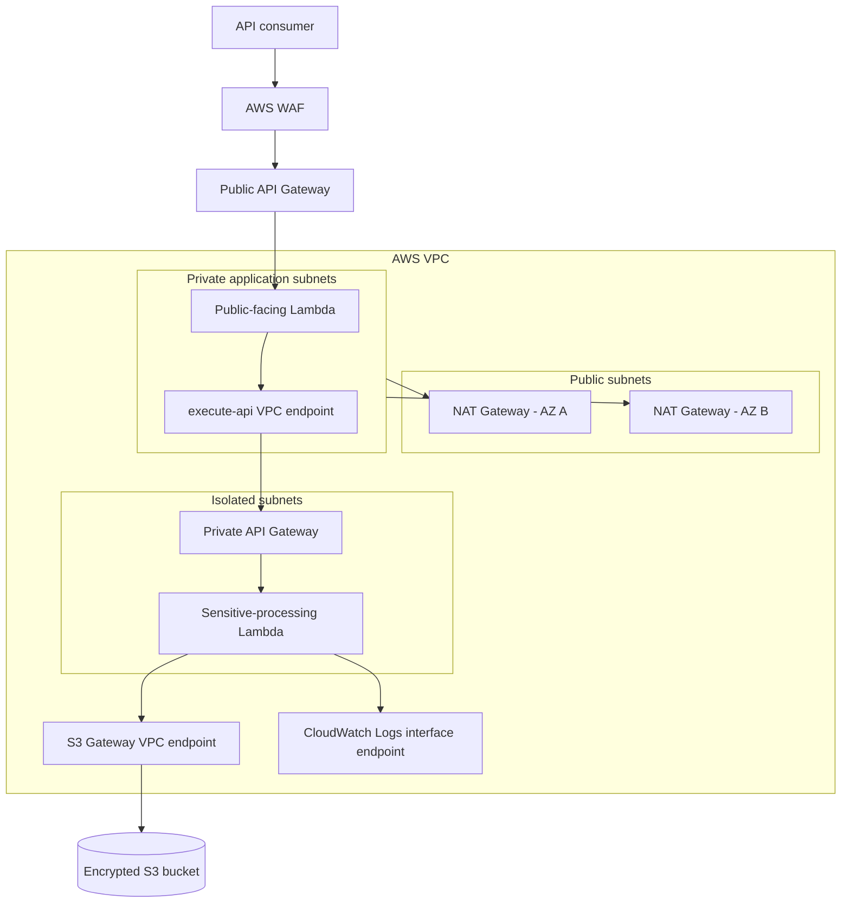

# AWS Secure Three-Tier Microservices Infrastructure

Terraform project for a secure, multi-tier AWS architecture that separates public API access, application processing, and sensitive data processing.

> **Implementation status:** The Terraform configuration was successfully initialized and passed `terraform validate` locally using Terraform CLI 1.11.4 in Docker. This confirms configuration validity, not successful AWS deployment. A Terraform plan and deployment have not yet been confirmed.

## Table of contents

- [1. Architecture overview](#1-architecture-overview)
- [2. Technical choices](#2-technical-choices)
- [3. Request flow](#3-request-flow)
- [4. Security considerations](#4-security-considerations)
- [5. Repository structure](#5-repository-structure)
- [6. Terraform and deployment workflow](#6-terraform-and-deployment-workflow)
- [7. How AI assisted the process](#7-how-ai-assisted-the-process)
- [8. Potential improvements](#8-potential-improvements)
- [9. Current implementation status and limitations](#9-current-implementation-status-and-limitations)

## 1. Architecture overview

The solution uses a VPC divided into three network tiers. The goal is to expose only the public API while keeping application components and sensitive data processing out of direct public reach.

### Logical architecture



The diagram is a logical view of the intended traffic flow. Actual routing, endpoint policies, security group rules, API resource policies, and AWS service integrations must be confirmed in the Terraform plan and during deployment testing.

### Network tiers

| Tier | Purpose | Internet access |
|---|---|---|
| Public subnets | Host NAT Gateways | NAT Gateways use Internet Gateways for outbound connectivity |
| Private subnets | Run the public-facing Lambda integration and application components that require controlled egress | Outbound access through NAT, subject to routing and security controls |
| Isolated subnets | Run sensitive processing components | No direct internet egress; access to required AWS services through VPC endpoints |

The design uses two Availability Zones for resilience. The development configuration is set up for two NAT Gateways, one per Availability Zone, to avoid making private-subnet outbound connectivity dependent on a single NAT Gateway.

## 2. Technical choices

### Amazon VPC and subnet segmentation

A dedicated VPC provides network isolation. Separating public, private, and isolated subnets makes the intended trust boundaries explicit and allows different routing and security policies for each tier.

### Amazon API Gateway

Two API Gateway endpoints represent different trust boundaries:

- **Public API Gateway:** receives requests from external API consumers and is protected by AWS WAF.
- **Private API Gateway:** provides an internal API surface for the public-facing Lambda to invoke the sensitive-processing service through a VPC endpoint.

The private API is intended to be reachable only through the configured VPC endpoint and its resource policy. The exact endpoint, DNS, and policy behavior must be verified in the target AWS account.

### AWS Lambda

The workload is split into two functions:

- **Public-facing Lambda:** handles the public API's application flow and invokes the private API.
- **Sensitive-processing Lambda:** handles the sensitive operation and accesses the S3 data store.

This separation supports independent IAM permissions and network controls. The sensitive function should receive only the permissions it needs to perform its operation.

### Amazon S3 and AWS KMS

S3 is used for data storage. Server-side encryption with AWS KMS is included in the infrastructure design. The sensitive Lambda's access is intended to be scoped to the required bucket path/prefix rather than granting broad bucket access.

### VPC endpoints

VPC endpoints reduce the need for internet egress when workloads communicate with supported AWS services:

- An S3 Gateway endpoint supports private access to S3.
- Interface endpoints support private access to required AWS APIs, including the private API invocation path and CloudWatch Logs, according to the configured endpoint resources.

Endpoint policies and security group rules should be reviewed to ensure they permit only the required actions and sources.

### AWS WAF

AWS WAF is associated with the public API Gateway stage. The web ACL includes:

- AWS Managed Rules Common Rule Set.
- AWS Managed Rules Known Bad Inputs Rule Set.
- A rate-based rule that blocks requests exceeding the configured per-IP threshold.

The rate threshold is configurable through Terraform variables.

### IAM and Terraform Cloud authentication

Lambda execution roles are separated by function. The intent is to apply least privilege and avoid sharing a single broad role between public and sensitive processing.

Terraform Cloud is configured as the remote execution/state platform. AWS authentication is designed to use dynamic credentials through OIDC rather than long-lived AWS access keys. The Terraform Cloud workspace must have the required AWS provider authentication environment variables and a correctly scoped AWS IAM role trust policy.

## 3. Request flow

1. An external client sends a request to the public API Gateway endpoint.
2. AWS WAF evaluates the request against the configured managed rule groups and rate-based rule.
3. The public API Gateway invokes the public-facing Lambda.
4. The public-facing Lambda invokes the private API Gateway through the configured `execute-api` VPC endpoint.
5. The private API Gateway invokes the sensitive-processing Lambda.
6. The sensitive-processing Lambda performs the protected operation and accesses the encrypted S3 object path using its execution role and the S3 VPC endpoint.
7. The result is returned through the private API Gateway to the public-facing Lambda.
8. The public-facing Lambda returns the response to the external client. The public response should contain only information approved for external disclosure.

The application handlers included in this repository are starter/example implementations. They must be reviewed and adapted to the actual business payload, data model, error handling, and response contract before production use.

## 4. Security considerations

The design applies defense in depth:

- **Network segmentation:** separate public, private, and isolated subnet tiers.
- **Restricted sensitive processing:** no direct internet egress from the isolated Lambda security group; required AWS service access is intended to use VPC endpoints.
- **Private API access:** private API Gateway access is restricted through a VPC endpoint/resource policy.
- **Least privilege:** distinct Lambda execution roles and scoped permissions.
- **Encryption:** S3 server-side encryption using AWS KMS.
- **Perimeter protection:** AWS WAF managed rules and rate limiting on the public API.
- **Short-lived AWS credentials for Terraform:** OIDC-based dynamic credentials through Terraform Cloud, rather than static AWS keys.

These controls are configuration goals, not a substitute for a security assessment. Before production use, inspect the generated IAM policies, bucket policy, KMS key policy, endpoint policies, route tables, security groups, API resource policies, logging, and WAF behavior in the actual plan and deployed environment.

## 5. Repository structure

```text
.
├── environments/
│   └── dev/
│       ├── main.tf
│       ├── outputs.tf
│       ├── providers.tf
│       └── variables.tf
├── lambda-src/
│   ├── public/
│   │   └── handler.py
│   └── sensitive/
│       └── handler.py
├── modules/
│   ├── api/
│   ├── api-integration/
│   ├── endpoints/
│   ├── lambda/
│   ├── networking/
│   ├── security/
│   ├── storage/
│   └── waf/
└── terraform-cloud-oidc/
    └── README.md
```

The `environments/dev` directory is the Terraform root module for the development environment. Reusable AWS resources are organized under `modules/`. Lambda source code is kept separate from the Terraform module definitions.

## 6. Terraform and deployment workflow

### Tooling

- Terraform CLI 1.11.4
- AWS provider constraint `~> 6.0`
- Archive provider constraint `~> 2.7`
- Terraform Cloud for remote state and execution
- GitHub repository as the source-control integration

### Local formatting and validation

The local machine used for initial validation runs Terraform through Docker. From `environments/dev`, the repository root is mounted into the container:

```bash
# Format all Terraform files
docker run --rm \
  -v "$PWD/../..":/workspace \
  -w /workspace \
  hashicorp/terraform:1.11.4 fmt -recursive

# Initialize providers locally without initializing the remote backend
docker run --rm -it \
  -v "$PWD/../..":/workspace \
  -w /workspace/environments/dev \
  hashicorp/terraform:1.11.4 init -backend=false

# Validate the configuration
docker run --rm -it \
  -v "$PWD/../..":/workspace \
  -w /workspace/environments/dev \
  hashicorp/terraform:1.11.4 validate
```

The configuration passed `terraform validate` locally. The `.terraform.lock.hcl` file created during initialization should be committed so provider selections remain reproducible.

### Terraform Cloud workflow

The intended workflow is:

1. Commit and push the Terraform changes to the GitHub branch connected to the Terraform Cloud workspace.
2. Terraform Cloud detects the new commit and starts a run, according to the workspace's VCS and run-trigger settings.
3. Review the generated plan.
4. Confirm the plan contains only expected resources and changes.
5. Apply only after review and explicit approval.

The workspace is expected to use the configured working directory `environments/dev`. Confirm that the workspace name, organization, project, branch, and working directory match the actual Terraform Cloud configuration.

### AWS OIDC prerequisites

The Terraform Cloud workspace and AWS IAM role must be configured for OIDC-based dynamic credentials. The workspace should define the required provider authentication settings, including:

- `TFC_AWS_PROVIDER_AUTH=true`
- `TFC_AWS_RUN_ROLE_ARN` set to the intended IAM role ARN

The IAM role trust policy must trust the correct Terraform Cloud OIDC identity and be scoped to the intended organization, project, and workspace. Do not commit AWS credentials or other secrets to the repository.

## 7. How AI assisted the process

AI (ChatGPT) was used as a development assistant during the design and implementation process. Its contributions included:

- Discussing the requirements and translating them into a proposed AWS network and application architecture.
- Suggesting a modular Terraform repository structure.
- Drafting Terraform resources, variables, outputs, and example Lambda handlers.
- Explaining AWS services and security mechanisms such as API Gateway, Lambda, VPC endpoints, IAM, KMS, S3, NAT Gateways, and WAF.
- Helping troubleshoot local tooling on macOS and run Terraform through Docker.
- Interpreting Terraform formatting, initialization, and validation errors.
- Proposing corrections to Terraform syntax, including the WAF configuration.

AI-generated code and recommendations were treated as drafts and were reviewed through command-line feedback and Terraform validation. AI assistance does not replace engineering review, security review, testing, or responsibility for the final implementation. The local `terraform validate` result confirms configuration validity only; it does not prove that the infrastructure has been deployed or that every runtime interaction works as intended.

## 8. Potential improvements

Given more time, the solution could be improved in the following areas:

### Automated testing and policy checks

- Add Terraform unit/module tests and integration tests for the API request flow.
- Add Terratest or equivalent infrastructure tests for deployed resources.
- Add Checkov, tfsec, or another policy/security scanner to CI.
- Add automated checks for IAM wildcard permissions, public exposure, encryption, and endpoint policies.

### CI/CD and release controls

- Create a pipeline that runs formatting, initialization, validation, static analysis, and tests for every pull request.
- Require code review and a Terraform Cloud plan review before apply.
- Separate development, staging, and production workspaces and variables.
- Pin and periodically update provider versions through a controlled dependency update process.

### Observability and operations

- Add structured application logs, CloudWatch dashboards, alarms, and actionable notifications.
- Add distributed tracing with AWS X-Ray or an OpenTelemetry-based approach.
- Define log retention, redaction, and access controls for sensitive data.
- Add service-level indicators for API latency, error rates, throttling, and Lambda failures.

### Resilience and recovery

- Define backup, retention, and recovery requirements for S3 data.
- Evaluate S3 versioning, lifecycle rules, replication, and recovery testing.
- Test failure scenarios across Availability Zones and AWS service dependencies.
- Define operational runbooks and incident response procedures.

### Security hardening

- Perform a detailed least-privilege review of Lambda roles, KMS key policies, S3 bucket policies, VPC endpoint policies, and API Gateway resource policies.
- Add secret-management patterns where application secrets are required.
- Review WAF managed-rule tuning, false positives, and rate limits using representative traffic.
- Consider organization-wide controls such as AWS Config, CloudTrail, GuardDuty, and Security Hub.
- Add threat modeling and a formal security review before production use.

### Cost and performance

- Estimate and monitor costs for NAT Gateways, API Gateway, Lambda, WAF, VPC endpoints, CloudWatch, and S3.
- Evaluate whether two NAT Gateways are justified for each environment's availability and cost requirements.
- Add load tests and tune Lambda memory, timeout, concurrency, and API throttling based on measured behavior.

## 9. Current implementation status and limitations

- The Terraform root module and reusable modules are present in the repository.
- The WAF syntax issue found during local validation was corrected.
- Terraform formatting was run recursively.
- Terraform initialization completed successfully with the configured AWS and Archive providers.
- `terraform validate` completed successfully using Terraform 1.11.4 in Docker.
- A successful Terraform Cloud plan, AWS deployment, end-to-end API test, and production security assessment have **not** been established by the local validation result.

Before deployment, review the Terraform Cloud workspace settings and OIDC trust relationship, inspect the complete plan, verify the AWS region and account, and test the request flow and security boundaries in a non-production environment.
